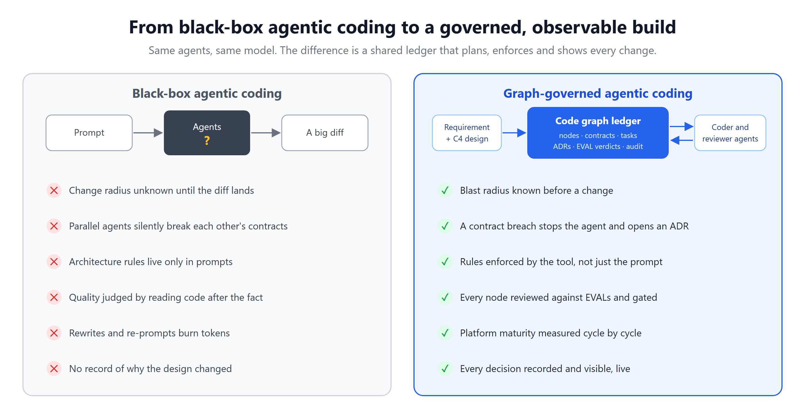
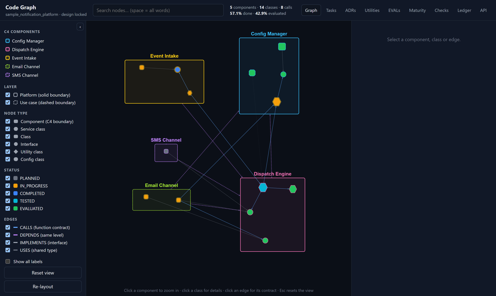
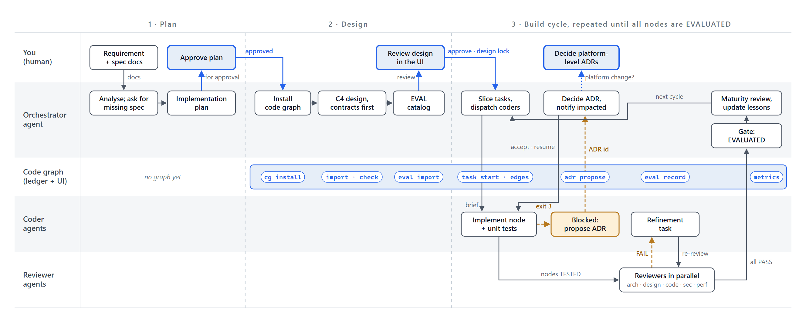
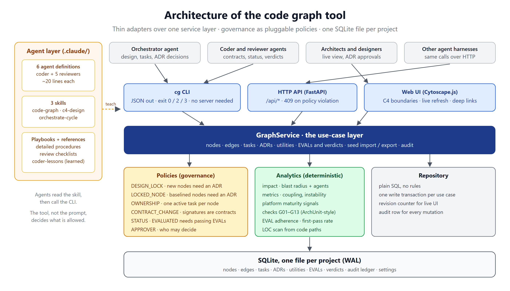

# Code Graph: observable, governed agentic coding

AI coding agents are fast, but they usually work as a black box: the plan and the rules live in a prompt, and the only thing you can inspect is the diff at the end. This repository opens the box.

It contains a **code graph tool** and a ready-made **agent layer** (agents, skills and playbooks for Claude Code) that together let a team of agents plan, build and review software against a shared, live ledger:

- The design is decomposed into **C4 nodes** (components, service classes, classes, interfaces, config and utility classes) before any code exists.
- Every call between classes is a recorded **contract** with its exact signature and purpose.
- Every task, change, **ADR** and **EVAL** verdict is written to the graph as it happens, and people watch it in a web UI.
- The **tool, not the prompt, decides what is allowed**: contract breaches, edits to another agent's work and changes to reviewed code are refused with exit code 3 until an ADR is accepted.



## Why use it

- **Fewer rewrites, lower token spend.** Contracts are agreed before coding, and the change radius of any edit is known before it is made.
- **Parallel agents without collisions.** A node belongs to one active task; contract changes are coordinated through ADRs with an exact list of impacted agents.
- **Architecture that holds.** Platform-first layering, dependency rules and lifecycle gates are enforced by the tool.
- **Decisions you can audit.** ADRs are linked to the nodes they cover, and every mutation is in an audit ledger.
- **Quality you can measure.** Reviewers record a verdict per node and EVAL; the first-pass rate shows which rules coders follow without being told.
- **Platform maturity you can see.** Coupling, instability and how often use cases forced platform changes, tracked cycle by cycle.
- **Works beside any agent harness.** Everything is a CLI call or an HTTP request.

## What's in the repository

```
code_graph_tool/          the tool (Python, SQLite, FastAPI, Cytoscape.js UI)
  cg.py                   CLI entry point
  codegraph/              domain, policies, service, analytics, CLI and API adapters
  ui/                     web UI (vendored Cytoscape.js + fcose layout)
  examples/               sample seed (a notification platform) and a demo session script
  tests/                  pytest suite
.claude/
  agents/                 coder + 5 reviewers (architecture, app design, code, security, performance)
  skills/                 code-graph (tool usage), c4-design and orchestrate-cycle (orchestrator)
  playbooks/              detailed procedures, review checklists, coder-lessons
docs/images/              images used in this README
```

Agent definitions and skills are deliberately lean (about 20–40 lines) and point to the playbooks and reference files for detail, so each agent loads little context.

## Quick start: see it working

```bash
cd code_graph_tool
pip install -r requirements.txt          # the CLI needs only the standard library; the UI needs fastapi + uvicorn
python examples/demo.py                  # replays a small orchestrated build into examples/demo.db
python cg.py --db examples/demo.db serve --port 8770
# open http://127.0.0.1:8770/ui/
```

The demo plays an orchestrator, four coders and three reviewers against the sample project. Along the way the tool blocks an edit to another agent's node, holds a node at the EVALUATED gate because of a review failure, stops a contract change until an ADR is accepted, and refuses a new node after the design lock until it has an ADR.



## Use it on your project

```bash
# 1. Install a copy of the tool (and, optionally, the agents and skills) into your project
python code_graph_tool/cg.py install path/to/your_project --with-claude

# 2. Write a contract-first C4 seed (see .claude/skills/code-graph/reference/seed-format.md) and import it
cd path/to/your_project
python code_graph/cg.py import design/c4_seed.json --actor orchestrator
python code_graph/cg.py eval import .claude/skills/c4-design/reference/baseline-evals.json --actor orchestrator
python code_graph/cg.py check                       # must report no ERRORs
python code_graph/cg.py design lock --actor orchestrator

# 3. Watch it while agents work
python code_graph/cg.py serve --port 8770
```

With Claude Code, the main session acts as the orchestrator using the `c4-design` and `orchestrate-cycle` skills, and dispatches the `coder` and reviewer agents. Each agent reads the `code-graph` skill and its playbook, and talks to the graph only through `cg`.



## How it works

### The graph
- **Nodes** carry business intent, anticipated extensibility and pattern, a contract summary, code path, lines of code, a 1–10 complexity score, lifecycle status (PLANNED → IN_PROGRESS → COMPLETED → TESTED → EVALUATED), a change count, and linked tasks, ADRs, verdicts and history. Fan-in and fan-out are derived from CALLS edges.
- **Edges:** `HAS` (containment), `DEPENDS` (component to component), `CALLS` (function contract with signature and purpose), `IMPLEMENTS` (class to interface) and `USES` (shared type imported without a call).

### Governance (exit code 3, HTTP 409)
| Policy | Blocks | Passes when |
|---|---|---|
| `DESIGN_LOCK` | adding or removing nodes after the design is locked | an accepted ADR is given |
| `LOCKED_NODE` | changing a TESTED or EVALUATED node | an accepted ADR covers it, or it is a refinement of a failing review |
| `OWNERSHIP` | touching a node inside another agent's active task | you work in the owning task |
| `CONTRACT_CHANGE` | changing a signature others use, or demanding a new function from a node someone else owns or that is baselined | an accepted ADR covers the callee |
| `STATUS` | skipping lifecycle gates; EVALUATED with a failing EVAL | the preconditions hold |
| `APPROVER` | accepting ADRs, locking the design, changing settings | the actor is an approver |

Policies are small classes in `codegraph/rules.py`; pass your own list to `GraphService(policies=...)`.

### EVALs and checks
- A baseline catalog of EVALs (architecture, application design, code, business, security, performance) lives in `.claude/skills/c4-design/reference/baseline-evals.json`; projects add their own.
- `cg check` runs deterministic, ArchUnit-style rules over the graph: platform-to-use-case dependencies, component cycles, undeclared or concrete cross-component calls, missing parents, sizes and complexity, collaborator limits, interfaces without implementers, and calls to functions an interface no longer declares.
- `cg eval report` gives the first-pass rate per EVAL and per coder. The orchestrator turns the least-followed EVALs into lessons in `.claude/playbooks/coder-lessons.md`.

### Analysis
- `cg impact <node>`: blast radius (callers, implementers, dependents), contracts involved, agents to notify.
- `cg metrics`: progress, per-component coupling, instability, abstractness, distance from the main sequence, and platform maturity signals.
- `cg scan-loc [--task T] [--dry-run]`: measures lines of code from node code paths.



### Design of the tool
Thin adapters (CLI, HTTP API, UI) over one service layer; governance as pluggable policies; deterministic analytics; plain-SQL repository; one SQLite file per project in WAL mode. See [`code_graph_tool/README.md`](code_graph_tool/README.md) for the module map and the full command reference in [`.claude/skills/code-graph/reference/cli.md`](.claude/skills/code-graph/reference/cli.md).

## Using it with another agent harness

The graph does not replace your harness. Your harness reads C4 context (`cg task get`, `cg node get` or `GET /api/nodes/{id}`), treats exit code 3 / HTTP 409 as a circuit breaker and routes the change through `cg adr propose`, and reports changes (`cg task`, `cg edge add`, `cg node status`) and verdicts (`cg eval record`). You can adopt it in steps: observe only, then govern, then coordinate parallel agents through task ownership.

## Development

```bash
cd code_graph_tool
python -m pytest -q
```

## Roadmap
- MCP server and hooks so other harnesses can call the graph natively
- An import scan that flags imports without a matching edge
- More than one ADR per task
- Component nodes that roll up their children's status and size
- A CI step that fails a build on architecture errors

## License and attribution

Free to use, modify and redistribute, including commercially, under the [Apache License 2.0](LICENSE).

If you redistribute it or build on it, keep the [NOTICE](NOTICE) file with your copy; the license requires that. When you use it or write about it, please credit the author:

> Based on Code Graph by aishwaryajayanth1820-git (https://github.com/aishwaryajayanth1820-git/code_graph_agentic_observable_coding)

GitHub's **Cite this repository** button gives the same credit from [CITATION.cff](CITATION.cff). The bundled UI libraries keep their own MIT licenses; see [THIRD_PARTY_NOTICES.md](THIRD_PARTY_NOTICES.md).
